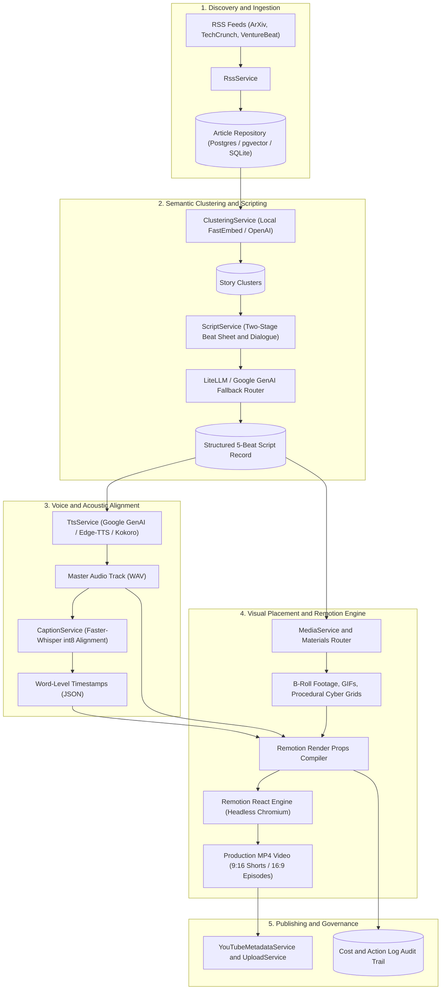

# Newsroom AI


[](https://mypy-lang.org/)
[](https://www.python.org/)
[](LICENSE)


Autonomous AI news video studio that transforms daily research papers and tech headlines into stylized vertical shorts (9:16) and widescreen episodes (16:9) using Remotion, LiteLLM, Prefect, and Faster-Whisper.

---

## Table of Contents

- [Overview](#overview)
- [Architecture Flow Diagram](#architecture-flow-diagram)
- [Directory Structure](#directory-structure)
- [Engineering Highlights](#engineering-highlights)
- [Sample Artifacts](#sample-artifacts)
- [Quickstart Guide](#quickstart-guide)
  - [Zero-Key Offline Demo](#1-zero-key-offline-demo)
  - [Full Production Setup](#2-full-production-setup)
- [CLI Command Reference](#cli-command-reference)
- [Configuration and Environment Variables](#configuration-and-environment-variables)
- [Deployment Options](#deployment-options)
  - [Option 1: Static Client Showcase (GitHub Pages & Hugging Face)](#option-1-static-client-showcase)
  - [Option 2: Serverless Deployment with Modal](#option-2-serverless-deployment-with-modal)
  - [Option 3: Container Deployment with Docker](#option-3-container-deployment-with-docker)
- [Testing and Quality Assurance](#testing-and-quality-assurance)
- [Automated Reviewers and Governance](#automated-reviewers-and-governance)
- [Architecture Standards](#architecture-standards)
- [License](#license)

---

## Overview

Newsroom AI is an automated video production engine that removes the manual bottleneck of creating daily technical content. Instead of requiring separate writers, voice actors, and video editors, the platform operates as an end-to-end automated pipeline:

1. **Discovery and Ingestion**: Pulls raw RSS feeds from curated tech sources (ArXiv, TechCrunch, VentureBeat, GitHub Trending).
2. **Semantic Clustering**: Uses vector embeddings and cosine similarity clustering to detect breaking narrative clusters.
3. **Structured Scripting**: Chains two-stage LLM prompts to synthesize structured 5-beat story sheets and comedic commentary.
4. **Voice Synthesis**: Generates expressive narration audio via Google GenAI Speech, Edge-TTS, or local Kokoro models.
5. **Acoustic Alignment**: Aligns spoken words to sub-frame millisecond timestamps using Faster-Whisper int8 models.
6. **Visual Asset Routing**: Selects relevant visual b-roll clips (Pexels, Giphy) or generates procedural canvas animations.
7. **Remotion Motion Graphics**: Renders production MP4 videos in 9:16 (Shorts/TikTok) or 16:9 (YouTube) via a containerized Remotion React engine.
8. **Publishing Packages**: Produces complete YouTube publishing packages with titles, description chapters, and SEO tags.

All operations execute under sub-cent unit economics, strict cost guardrails, and automated circuit breakers.

---

## Architecture Flow Diagram



---

## Directory Structure

The repository enforces strict separation of concerns across layered modules:

```
/
|-- src/
|   |-- cli.py               # Typer CLI commands (no business logic)
|   |-- web.py               # FastAPI HTTP API endpoints
|   |-- core/                # Configuration and database engine setup
|   |-- flows/               # Prefect pipeline workflow definitions
|   |-- models/              # Pydantic schemas and SQLAlchemy entities
|   |-- repositories/        # Data access layer for articles, jobs, and costs
|   \-- services/            # Core business logic (RSS, clustering, TTS, Remotion)
|-- remotion/                # React video compositions and kinetic caption canvas
|-- docs/                    # GitHub Pages static client bundle (mirrors index.html)
|-- examples/                # Sample pipeline artifacts (clusters, scripts, captions)
|-- prompts/                 # Jinja2 prompt templates for beat sheets and scripts
|-- scripts/                 # Operational utilities and CI inspection tools
|-- tests/                   # Pytest test suite (unit, integration, client contracts)
|-- index.html               # Interactive static showcase single page application
|-- modal_app.py             # Serverless deployment specification for Modal
|-- pyproject.toml           # Project metadata, dependencies, and tooling configuration
\-- docker-compose.yml       # Local PostgreSQL + pgvector and LiteLLM services
```

---


## Sample Artifacts

The repository includes realistic pipeline artifacts in the [examples/](examples/) directory:

- [examples/sample_story_cluster.json](examples/sample_story_cluster.json): Semantic cluster of AI articles with cosine similarity scores, topic keywords, and source article summaries.
- [examples/sample_beat_sheet.json](examples/sample_beat_sheet.json): 5-beat story structure (Hook, Context, Breakdown, Skepticism, Outro) specifying emotional tone, visual direction, and screen headlines.
- [examples/sample_word_captions.json](examples/sample_word_captions.json): Word-level timestamp alignment generated by Faster-Whisper for kinetic typography.
- [examples/sample_video_metadata.json](examples/sample_video_metadata.json): Generated YouTube publishing package including title variants, description with chapters, and SEO tags.

---

## Quickstart Guide

### 1. Zero-Key Offline Demo

You can execute a full demonstration of all pipeline stages without configuring any external API keys or third-party accounts:

```bash
# Clone the repository
git clone https://github.com/BUZEL-112/silver-tribble.git
cd silver-tribble

# Create and activate Python virtual environment
python3 -m venv .venv
source .venv/bin/activate  # On Windows: .venv\Scripts\activate

# Install locally from repository source
pip install --upgrade pip
pip install -e ".[dev]"

# Run the zero-key pipeline demo via CLI tool
newsroom-ai demo
# Aliases: newsroom demo, pipeline demo, ai-video demo
```

Run demo with custom options:

```bash
# Output machine-readable JSON
newsroom-ai demo --json

# Run horizontal widescreen (16:9) demo
newsroom-ai demo --aspect-ratio 16:9
```

### 2. Full Production Setup

For live production runs with live RSS feeds and real API synthesis:

```bash
# 1. Configure environment variables
cp .env.example .env
# Add your GEMINI_API_KEY, OPENAI_API_KEY, or DEEPSEEK_API_KEY to .env

# 2. Start PostgreSQL with pgvector and LiteLLM proxy
docker compose up -d

# 3. Initialize database tables
python -m src.cli setup-db

# 4. Install Remotion React dependencies
cd remotion
npm install
cd ..

# 5. Execute live automated pipeline run
python -m src.cli run --auto-top --aspect-ratio 9:16
```

---

## CLI Command Reference

The command-line interface provides dedicated commands for each stage:

| Command | Description | Example |
| :--- | :--- | :--- |
| `demo` | Run zero-key end-to-end sandbox pipeline | `python -m src.cli demo` |
| `setup-db` | Initialize database schema and vector extensions | `python -m src.cli setup-db` |
| `ingest` | Fetch latest articles from curated AI RSS feeds | `python -m src.cli ingest` |
| `cluster` | Compute embeddings and group stories into clusters | `python -m src.cli cluster --threshold 0.82` |
| `clusters` | Inspect story clusters and constituent articles | `python -m src.cli clusters --limit 10` |
| `script` | Generate structured 5-beat sheet and narration script | `python -m src.cli script --cluster-id 1` |
| `roundup` | Generate multi-topic news roundup script | `python -m src.cli roundup --top-n 3` |
| `voice` | Synthesize TTS narration and compute Whisper alignment | `python -m src.cli voice --script-id 1` |
| `media` | Fetch sentence-level visual assets (Pexels, Giphy) | `python -m src.cli media --job-id 1` |
| `render` | Compile and render video through Remotion React engine | `python -m src.cli render --job-id 1` |
| `run` | Execute complete pipeline from ingestion to video MP4 | `python -m src.cli run --auto-top` |
| `publish` | Generate YouTube titles, chapters, and SEO metadata | `python -m src.cli publish --job-id 1` |
| `costs` | View per-stage spend, units, and total costs | `python -m src.cli costs` |
| `health` | Run diagnostics on DB, storage, and external providers | `python -m src.cli health` |
| `ui` / `web` | Launch FastAPI web dashboard | `python -m src.cli ui --port 8000` |
| `export-litellm-config` | Export active provider config to LiteLLM YAML | `python -m src.cli export-litellm-config` |

---

## Configuration and Environment Variables

The application reads configuration from `.env` and `config.yaml`:

| Variable | Description | Default |
| :--- | :--- | :--- |
| `GEMINI_API_KEY` | Google Gemini API key for scripting and speech | Optional (uses offline fallbacks if unset) |
| `OPENAI_API_KEY` | OpenAI API key for GPT models and embeddings | Optional |
| `DATABASE_URL` | PostgreSQL connection string with pgvector support | `sqlite:///./test.db` |
| `API_AUTH_TOKEN` | Bearer token required for FastAPI web endpoints | Optional in development |
| `LITELLM_BASE_URL` | Base URL for LiteLLM proxy instance | `http://localhost:4000` |
| `LITELLM_API_KEY` | Master key for authenticating with LiteLLM | `sk-litellm-master-key` |
| `PEXELS_API_KEY` | API key for fetching b-roll video clips | Optional (procedural graphics fallback) |
| `GIPHY_API_KEY` | API key for fetching reaction GIFs | Optional |
| `REMOTION_CONCURRENCY` | Maximum concurrent Chromium render threads | `2` |
| `MAX_DAILY_BUDGET_USD` | Hard budget cap before circuit breaker trips | `10.0` |

---

## Deployment Options

### Option 1: Static Client Showcase (GitHub Pages & Hugging Face)

The repository provides a standalone interactive showcase application in `index.html` and `docs/index.html`. It runs with zero infrastructure costs:

1. **GitHub Pages**:
   - Go to repository **Settings > Pages**.
   - Under **Build and deployment**, select **Deploy from a branch** and choose `/docs` on the `main` branch.
   - Your static site will be live at `https://<your-username>.github.io/<repo-name>/`.
2. **Hugging Face Static Space**:
   - Create a new Space on [Hugging Face](https://huggingface.co/new-space) and select **Static** as the SDK.
   - Push this repository to your Space.
   - The showcase will be live at `https://huggingface.co/spaces/<your-username>/<space-name>`.
3. **Connecting Static Client to Backend**:
   - Click **API Settings** in the top navigation bar.
   - Enter your deployed Modal or Cloud Run backend URL (for example, `https://<workspace>--ai-video-pipeline-web.modal.run`).
   - Enter your `API_AUTH_TOKEN` if authentication is configured.
   - Click **Test Connection** to verify live connectivity.

### Option 2: Serverless Deployment with Modal

The platform includes a dedicated [modal_app.py](modal_app.py) specification to run the complete FastAPI backend, Remotion React rendering engine, Node.js 22, and headless Chromium in a serverless container on Modal:

```bash
# 1. Install Modal CLI and authenticate
pip install modal
modal setup

# 2. Deploy the serverless app
modal deploy modal_app.py
```

Modal provides automatic scale-to-zero when idle, eliminating idle server expenses while rendering full Remotion compositions with hardware-accelerated media libraries.

### Option 3: Container Deployment with Docker

For self-hosted container environments (Railway, Render, Fly.io, or local Docker):

```bash
# Build and run with Docker Compose
docker compose up -d --build
```

The Docker container runs as non-root UID `1000`, exposes port `7860`, and bundles Python 3.12, Node.js 22 LTS, FFmpeg, and headless Chromium libraries.

---

## Testing and Quality Assurance

The codebase enforces strict automated testing and formatting standards:

```bash
# Run unit and integration tests (excludes manual browser tests)
pytest -m "not manual and not postgres"

# Run client contract tests
pytest tests/test_client_layer.py

# Run static type checking
mypy src
```

---

## License

This project is licensed under the MIT License. See the [LICENSE](LICENSE) file for details.
