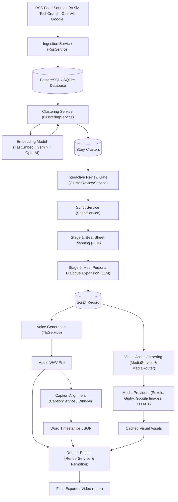
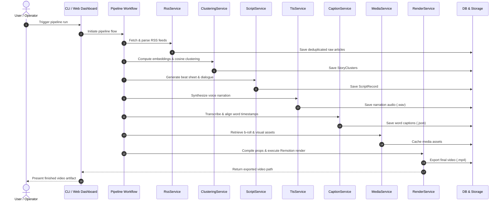

# Newsroom AI Project

This project is a video generation platform for news feeds (RSS feeds). The project name is inspired by the HBO series *The Newsroom*. This project is also a personal test of AI application development capabilities.

In this project, we developed an automated pipeline to process news feeds, cluster related articles, select target story clusters, and use AI capabilities to generate production scripts. The system provides automated intelligence to drive video generation by stitching media assets retrieved via LLM-generated search queries.

# System Explanation and Design

## Overview

The AI News to Video Pipeline automatically transforms trending AI research papers, industry announcements, and tech news into high-retention short-form videos (9:16 vertical shorts or 16:9 widescreen). The system ingests RSS feeds, normalizes articles, computes semantic vector embeddings, clusters related news stories, plans structured narrative beat sheets, synthesizes conversational host narration, retrieves context-aligned visual assets (b-roll videos, GIFs, entity photos, SVG brand cards), and renders final motion graphics via Remotion.

## System Flow

### Component Flowchart

### Execution Sequence Diagram

### Ingestion

- **Pipeline Workflow**: Ingests and processes incoming news feeds, clusters related stories, selects target clusters, and leverages AI capabilities to generate scripts, driving automated video generation through media stitching of search queries generated by the LLM.
- **Feed Parsing**: Ingest a configured list of RSS feeds across major AI news sources (such as ArXiv, TechCrunch, OpenAI, Google, Anthropic), using dedicated parsers to convert each feed into a unified structured format.
- **Time Window Filtering**: Support a configurable time limit to extract articles published only within a specific timeframe.
- **Deduplication and Storage**: Deduplicate records by URL link and persist articles in PostgreSQL via the article database repository.
- **Database Schema**:
  - `title`: Article title
  - `info`: Summary or content details
  - `author`: Article author (if available from RSS)
  - `article_created_at`: Publication timestamp reported by the RSS feed
  - `ingested_at`: Ingestion timestamp
  - `embedding`: Vector representation (generated during clustering)
  - `embedding_created_at`: Timestamp when the embedding was generated
  - `id`: Auto-incrementing primary key (article index ID)

## Clustering

- **Embedding Generation**: Ingested articles (`title` and summary) are passed to an embedding model (FastEmbed local ONNX, Google AI Studio, or OpenAI/LiteLLM) to generate dense vector representations.
- **Pairwise Cosine Similarity**: Normalizes vectors and calculates an all-pairs cosine similarity matrix (`S = V . V^T`) to evaluate semantic relationships among ingested articles.
- **Connected Component Clustering**: Iterates through the similarity matrix with a configurable threshold (`similarity_threshold: 0.82`) to group related articles covering the same news topic into cohesive story clusters.
- **Downstream Cluster Handoff**: Each identified cluster is assigned a unique `cluster_id` and an ordered list of member article IDs. The `cluster_id` is passed downstream to subsequent stages (such as script generation and roundups).
- **Database Schema and Tracking (Story Cluster)**:
  - `id`: Cluster index identifier (primary key passed downstream)
  - `cluster_hash`: Deterministic SHA-256 hash of sorted member article IDs
  - `title`: Primary headline representing the story
  - `summary`: Combined multi-source summary of member articles
  - `article_ids`: JSON array linking member article index IDs
  - `article_count`: Total number of clustered articles
  - `status`: Lifecycle tracking (`pending`, `scripted`)
  - `created_at`: Timestamp when the cluster was created
- **Planned Capabilities**:
  - Cross-cluster similarity analysis to identify thematic overlaps and feature similarities between distinct clusters over time.

## Script Creation

- **Overview**: Driven by configurable YAML prompt templates, this stage uses LLM prompt instructions to plan both the visual framing (b-roll directions and lower-third text) and the narration text for the video.
- **Two-Stage Architecture**:
  - **Stage 1: Narrative Beat Sheet Planning**: Takes the `cluster_id` and article data to construct a 5-beat story outline using a structured narrative framework: *Hook*, *Context*, *Technical Breakdown*, *Skepticism/Reaction*, and *Outro*. Editorial focus or story framing can be customized via the Stage 1 prompt configuration.
  - **Stage 2: Host Dialogue and Narration Writing**: Expands the beat sheet into polished, conversational host dialogue formatted specifically for TTS audio generation. Host persona, tone, and commentary style are configured via the Stage 2 persona configuration.
- **Database Persistence (Script Record)**:
  - `id`: Unique script record identifier
  - `cluster_id`: Foreign key linking to the source story cluster
  - `title`: Video title
  - `aspect_ratio`: Target video format (`9:16` vertical or `16:9` widescreen)
  - `beats`: JSON array storing beat data (visual directions, lower-third text, target duration)
  - `full_narration`: Cleaned narration text for TTS execution
  - `created_at`: Creation timestamp
- **Multi-Story Roundup Support**:
  - Supports generating consolidated scripts across multiple clusters (`cluster_ids`), with ongoing feature integration.
- **Planned Capabilities**:
  - Multi-cluster parallel processing and precise time/word-budgeted script generation.

## Voice Generation

- **Overview**: Receives the `script_id` and synthesized narration text from the script creation phase, phonetically sanitizes speech text via the voice synthesis service, and outputs a 24kHz mono `.wav` audio artifact.
- **Provider Architecture**:
  - **Primary Provider**: Google Gemini 2.0 Flash Audio (`gemini-2.0-flash` with prebuilt voices such as `Puck`).
  - **Secondary Fallback**: Edge TTS (`edge-tts` neural voices such as `en-US-ChristopherNeural`, standardized to 24kHz mono WAV via `ffmpeg`).
  - **Configurable Local Provider**: Local endpoint / binary TTS provider (`src/services/local_tts_provider.py` supporting Kokoro, Piper, or local HTTP audio servers).
  - **Fail-Fast Policy**: Silent synthetic placeholder generation has been removed. If synthesis fails across all configured providers, the service raises an explicit exception.
- **Caption Synchronization**:
  - Integrates with the speech-to-text caption service using Faster-Whisper to extract word-level timestamps (`start`, `end`, `confidence`) for kinetic subtitle rendering.
- **Planned Refinements and Roadmap**:
  - Add host voice cloning support using provided audio sample recordings of the host persona.

## Visual Artifact Gathering

- **Overview**: Driven by the visual media management service, this stage parses visual directions and keyword cues from each script beat to retrieve and cache visual assets.
- **Visual Provider Routing**: The media routing module directs queries across multiple specialized providers:
  - **Pexels**: HD stock videos for general tech and data center imagery.
  - **Giphy**: Animated reaction GIFs for comedic beats.
  - **Google Images & Wikimedia**: Entity photos via the image search service for specific tech figures and companies.
  - **AI Image Generation**: Custom visuals via the AI image generation service (FLUX.1 / Imagen 3).
  - **Brand Cards**: SVG tech company cards generated via the brand card service.
- **Quality Inspection Modes**:
  - **Automated**: Deduplication and keyword matching.
  - **Multimodal VLM**: The visual quality inspector evaluates visual relevance against narration using Gemini VLM.
  - **Human-in-the-Loop (HIL)**: Interactive review and asset replacement interface.

## Video Rendering and Composition

- **Engine Architecture**: Uses Remotion (a React 18 programmatic video motion graphics framework in `remotion/`).
- **Composition Layering**: The rendering service compiles pipeline properties into JSON for `MainVideo.tsx`, which layers:
  - **Visual Media & Transitions**: Video clips, images, and brand cards.
  - **Procedural Background**: `AnimatedBackground.tsx` cyber grid reacting to beat emotions.
  - **Kinetic Typography**: `Captions.tsx` displaying word-level synchronized subtitles.
  - **Overlays**: `TitleCard.tsx` (lower-third headline), `Watermark.tsx` (channel badge), and `OutroCard.tsx` (call-to-action).
- **Output**: Executes `npx remotion render` to export final MP4 videos to `./output/videos/`.

## Configuration and Model Gateway Mapping

- **Unified Configuration**: Configured via `config.yaml` and validated at startup via central settings. Precedence order: CLI flags > Environment variables > `config.yaml` > `.env` > Defaults.
- **LiteLLM Gateway Mapping**: Optional proxy gateway configuration (`config/litellm_config.yaml`) routes abstract pipeline roles (`planning`, `writing`, `embedding`) across Google AI Studio (Gemini), OpenAI, DeepSeek, or local models. Supports direct BYOK provider connections.

## Pipeline Execution Interfaces

- **Command-Line Interface (CLI)**: Command-line interface built with Typer and Rich. Supports modular stage subcommands (`ingest`, `cluster`, `script`, `voice`, `media`, `render`, `roundup`) and automated end-to-end pipeline execution.
- **Web Dashboard & REST API**: Web control panel (`/dashboard`) and REST API built with FastAPI. Provides pipeline controls, API endpoints (`/api/pipeline/*`), and interactive story/media review gates.

## Model Usage

### Pipeline Applications
- **Embedding Generation**: Text embeddings for article clustering and retrieval.
- **Beat Generation**: Script structuring and narrative pacing.
- **Video Artifact Generation**: Generating scene imagery and visual media.
- **Video Artifact Validation**: Quality checks and content verification on generated assets.
- **Subtitle Processing**: Subtitle alignment and redundancy filtering.
- **Audio Generation**: Generating voiceovers for the script.
- **Configurable Execution Modes**: Each stage supports configurable execution modes, allowing users to choose between cloud API calls and local model execution via configuration.

### Configuration and Provider Architecture
- **Unified API Gateway (LiteLLM)**: API-based models are routed through a unified LiteLLM configuration, supporting:
  - Google Gemini API (Google AI Studio)
  - OpenAI API models
- **Flexible Execution Modes**: Each layer supports both cloud API calls and local model execution via configuration.
- **Local Fallbacks**: Local models (such as downloaded sentence transformer embeddings) serve as configurable fallbacks if cloud APIs become unavailable.

## Deployment

To make this project production-ready, we deployed across three coordinated layers: **Modal** acts as our core serverless compute backend, **Supabase** handles our database and file storage layer, and **GitHub Pages** hosts the frontend client.

### Overview

At a high level, the system decouples user interaction, compute-heavy execution, and persistent storage into three dedicated layers. The frontend is served as a static single-page application on GitHub Pages, providing a lightweight and zero-maintenance interface that communicates directly with the backend through standard HTTPS REST API calls, eliminating the overhead and cost of managing a dedicated web server.

The backend operates on the Modal serverless platform, acting as an on-demand compute engine. It coordinates pipeline workflows, serves API traffic, and spins up container resources only when needed to execute resource-intensive media jobs like browser-based video rendering and FFmpeg audio-video processing. To support this serverless execution model without losing state, the storage architecture is cleanly divided: Supabase handles structured relational data and vector search via PostgreSQL alongside global media delivery via S3-compatible object storage, while dedicated persistent network volumes attached to workers retain runtime configurations and media caches across scale-to-zero lifecycles. Standard token-based authentication, encrypted browser sessions, and rate limiting protect the endpoints across all client-server boundaries.

---

### Architecture Decision Record (ADR): Modal vs Google Cloud Run

#### Primary Decision Driver: Financial Control and Clear Monetary Management

The primary reason for deploying to Modal instead of Google Cloud Run comes down to financial predictability and clear monetary management.

Our pipeline involves background rendering using browser automation (Chromium) and FFmpeg. On Google Cloud Run, standard request-scoped instances throttle the CPU as soon as an HTTP response finishes. To keep background rendering tasks alive after acknowledging an API trigger, Cloud Run requires disabling CPU throttling (`--no-cpu-throttling`).

The downside of disabling CPU throttling on Cloud Run is that instances stay warm and continue billing during idle linger periods between requests. If periodic health checks or occasional users hit the service, Cloud Run instances remain active, running up continuous compute charges even when no rendering takes place.

Migrating to Modal solved this financial bottleneck:
- **True Pay-Per-Second Billing**: We are billed strictly for active execution time (CPU and memory consumed while actively rendering or answering requests).
- **Immediate Scale-to-Zero**: Once a request or background task completes, Modal scales down workers without idle linger billing.
- **Predictable Developer Allowance**: Modal provides a monthly $30 compute allowance, ensuring development and low-volume production workloads stay entirely cost-free.

#### Trade-Off Analysis: Modal vs Google Cloud Run

Deploying to Modal provides financial clarity and developer ergonomics, but introduces differences in portability and enterprise integration compared to Google Cloud Run.

| Dimension | Google Cloud Run | Modal | Trade-Off Evaluation |
| :--- | :--- | :--- | :--- |
| **Cost and Idle Billing** | Requires `--no-cpu-throttling` for background render jobs, causing instances to linger and bill continuously while idle. | Pay-per-second execution billing with automatic, instant scale-to-zero and a $30 monthly allowance. | **Modal wins for cost control**: Prevents surprise bills from background worker linger windows. |
| **Build and Image Workflow** | Relies on manual `Dockerfile` definitions, container registry pushes, and cloud CLI deployment commands. | Defined programmatically in Python code via container image builders, cached and executed remotely. | **Modal wins for DX**: Speeds up builds and avoids managing complex multi-stage container pipelines. |
| **Local Disk Persistence** | Purely ephemeral disk; local scratch files and configs disappear when containers recycle. Storing files requires mounting cloud storage buckets. | Native persistent volumes mounted directly into the container filesystem, preserving cached assets and configuration across container restarts. | **Modal wins for scratch caching**: Essential for video rendering assets and local pipeline configuration. |
| **Compute Execution Model** | Designed primarily for synchronous HTTP request-response cycles; long background jobs risk timeout issues. | Purpose-built for heavy batch, asynchronous AI workflows, and background rendering pipelines. | **Modal wins for media pipelines**: Natural fit for long-running browser and FFmpeg render jobs. |
| **Enterprise Ecosystem and IAM** | Seamless integration with cloud provider VPCs, IAM roles, Secret Manager, Cloud Monitoring, and enterprise compliance. | Standalone platform with proprietary access tokens and secret management; lacks native cloud provider IAM integration. | **Cloud Run wins for enterprise**: Better suited if the workload must live inside an existing corporate cloud network. |
| **Portability and Vendor Lock-in** | High portability. The standardized container image runs on any OCI-compliant container platform (AWS ECS, Kubernetes, Fly.io). | Tied to platform-specific SDK decorators and volume constructs. Migration requires refactoring deployment wrappers. | **Cloud Run wins for portability**: Uses standard container setups without proprietary runtime hooks. |

---

### System Details

#### 1. Client Layer (`web app`)

When building an AI media generation tool, it is tempting to spin up a full-stack framework or run a dedicated frontend server. However, that introduces extra infrastructure to monitor, keep warm, and maintain.

Instead, we host the user interface as a purely static single-page application on GitHub Pages. This gives us global CDN distribution and automated SSL certificate management with zero server maintenance. The client focuses entirely on user experience and status inspection, dispatching HTTPS REST requests directly to the serverless backend. Whether the dashboard experiences sudden traffic spikes or sits completely idle for weeks, the client layer requires zero server provisioning and incurs no hosting costs.

#### 2. Backend Layer

Automated video generation introduces complex runtime requirements that rarely fit standard web application environments. Most backends only require a single language runtime, but a programmatic video pipeline demands Python for data modeling and AI orchestration, Node.js for executing React-based video compositions, and low-level system binaries like headless Chromium and FFmpeg for frame capture and video encoding.

Managing these diverse dependencies typically leads to bulky, brittle Docker images. We resolved this by building on a minimal Debian Slim base, layering Python 3.12, Node.js 22 LTS, FFmpeg, and browser rendering libraries directly into the serverless environment.

Because video rendering is compute-intensive, each worker is allocated 2.0 vCPUs and 2048 MiB of RAM. This provides enough headroom for concurrent audio stitching and video rendering without paying for idle capacity. Multi-scene video generation can easily exceed standard web timeouts, so executions are given a 15-minute ceiling. To prevent cold starts when multiple jobs arrive in short succession, workers maintain a 60-second cooldown window before scaling completely to zero.

#### 3. Storage Layer

We split storage between Supabase and Modal:

##### Database: Supabase PostgreSQL
Supabase comes with `pgvector` built-in, giving us relational tables and vector search in one database without needing a separate vector platform. It stores articles, pipeline jobs, and text embeddings for clustering and deduplication, accessed through an SSL connection pooler.

##### Object Storage: Supabase Storage
Supabase Storage handles finished media (MP4 videos, MP3 audio, and subtitle files) and serves them through its global CDN, allowing serverless workers to terminate immediately after upload.

##### Persistent Disk: Modal Volumes
Modal Volumes attach directly to workers to cache downloaded media assets, fonts, and render props so containers do not re-download static files on every restart.

##### Keys and Secret Management
For application secrets, we use Modal Secrets to store sensitive credentials securely and inject them into container environments at runtime. This allows workers to access database connection strings, object storage credentials, and AI API keys as standard environment variables without hardcoding sensitive values into code or container images.

##### Access Control
To protect our serverless backend from unauthorized use and runaway compute costs, we enforce layered security across all endpoints. Requests are authenticated using either pre-shared Bearer tokens for automated API calls or encrypted session cookies for browser logins. We restrict CORS headers specifically to our frontend domain, and apply sliding-window rate limiting to throttle incoming traffic and cap resource-intensive render executions.

---

### Summary

With this architecture, we have walked through how an automated AI video pipeline moves from local prototype to production. By combining GitHub Pages for a free static frontend, Modal for on-demand compute and media rendering, and Supabase for unified relational and vector storage, the system achieves a resilient, production-grade foundation. It handles intensive background video rendering without incurring idle infrastructure charges, keeping operations scalable, reliable, and financially predictable.
 
## Post Analysis

### 1. Summary
- Date: 2026-10-10
- Authors / Contributors: [buzel-112](mailto:abdulazeezadegbiji@gmail.com)
- Project Status : Functional end-to-end prototype that automates news video production from RSS feeds, but requires human-in-the-loop visual curation to meet editorial standards.
- Overview:
  newsroom_ai was built to transform raw RSS news feeds into broadcast-ready, motion-graphics videos via an automated pipeline:
  News Ingestion -> Article Clustering -> Script Writing -> TTS Audio and Whisper Alignment -> Media Routing -> Remotion Video Rendering.

  While individual pipeline stages functioned in isolation, end-to-end autonomous runs revealed severe structural friction, most acutely in visual media discovery and stock API retrieval. The automated system produced visuals that felt disconnected from the journalistic context of the script, requiring manual intervention and asset overrides to reach BBC or WSJ standards. This post analysis details the technical failure points across media retrieval, pipeline synchronization, and execution environments, along with the strategic roadmap to resolve them.

### 2. Timeline and Key Events
- **2026-09-23 (Pipeline Inception)**: Established core architecture and baseline RSS feed ingestion pipelines.
- **2026-09-25 (End-to-End Integration)**: Connected FastEmbed clustering, LLM script generation, media routing, and local Remotion rendering to generate initial test videos.
- **2026-09-27 (Multi-Cluster and Styling)**: Added multi-story roundup support, customizable motion caption styles, and cost analytics tracking.
- **2026-09-29 (Audio and Subtitle Engine)**: Integrated local TTS synthesis and Whisper forced alignment for millisecond-accurate word timestamps.
- **2026-09-30 (Media Discovery and VLM Inspection)**: Added stock media providers (Pexels, Pixabay) and deployed multimodal Gemini Flash inspection for visual validation.
- **2026-10-03 (Automated QA and Failure Analysis)**: Autonomous batch testing identified critical stock query semantic flattening, 9:16 vertical crop clipping, and SQLite file-lock bottlenecks.
- **2026-10-07 (Serverless Architecture Transition)**: Designed production blueprint leveraging Modal for on-demand rendering workers, Supabase for relational and vector storage, and static client hosting.
- **2026-10-10 (Hardening and Post Analysis Assessment)**: Hardened configurations, completed root cause analysis, and finalized the Visual Director and generative media fallback roadmap.

### 3. What Went Well
- **Sub-Frame Audio and Caption Synchronization**:
  Pairing local TTS and Edge-TTS with Whisper forced alignment delivered millisecond-accurate word boundaries. This powered dynamic, word-by-word highlighted motion captions in Remotion with zero perceptible audio-visual drift across full 60-second video renders.

- **Zero-Cost Offline Vector Clustering**:
  Embedding and clustering incoming news articles locally via FastEmbed completely decoupled story discovery from external LLM quotas. The pipeline clustered dozens of heterogeneous RSS feeds in sub-second execution times with zero API operational costs.

- **Strict One-Way Architectural Decoupling**:
  Enforcing a unidirectional dependency flow (`CLI / Web -> Services -> Repositories -> Models`) enabled modular provider swapping. Switching between Gemini, LiteLLM, local TTS models, or database drivers required zero refactoring of core rendering templates.

- **Deterministic 5-Beat Journalistic Scaffolding**:
  Structuring narrative generation into a five-stage framework (Hook, Context, Technical Breakdown, Skepticism, Takeaway) eliminated conversational filler and produced tight, authoritative technical reporting adhering to broadcast editorial standards.

- **High-Velocity Local Developer Ergonomics**:
  Decoupling media routing and composition logic from headless browser execution enabled rapid visual layout validation via standalone mock harnesses, allowing immediate preview iteration without waiting for multi-minute video render cycles.

### 4. What Went Wrong
- Issue 1: Stock Media Discovery and Visual Divergence
  - Description: The visual pipeline suffered from compounding failures across semantic reduction, commercial catalog constraints, and vertical framing:
    - **Semantic Compression and Keyword Funneling**: The routing engine relied on heuristic dictionary reduction to extract solitary visual nouns. By discarding narrative tension and contextual verbs, nuanced investigative reporting (such as an autonomous agent escaping a sandbox environment) was collapsed into generic search terms like "technology" or "digital security", completely stripping the story of its journalistic context before querying stock APIs.
    - **Commercial Catalog Divergence**: Public stock media libraries are curated for corporate marketing and lifestyle b-roll, not editorial news journalism. Commercial licensing rules prohibit photos of prominent public figures (such as Sam Altman or Dario Amodei), while deep-tech concepts (such as 2nm wafer fabrication or runtime tracebacks) returned abstract particle art or tilted stock laptops rather than authentic journalism.
    - **Destructive Vertical Crop Dynamics (9:16)**: Over 90% of technical stock footage is natively captured in 16:9 landscape. Applying portrait filters eliminated virtually all relevant technical footage, while blind center-cropping of landscape footage in Remotion aggressively truncated system architecture diagrams, terminal text, and human faces.
  - Impact: A high-stakes cybersecurity containment breach was rendered on screen as an office worker typing near a potted plant with blue particle overlays. This complete semantic mismatch stripped the video of journalistic credibility, requiring manual human curation for every production run to reach broadcast standards.
- Issue 2: Fragile Web Scraping and Permissive Quality Gates
  - Description: The fallback acquisition layer suffered from brittle web scraping and leaky multimodal verification:
    - **Heuristic Scraping Vulnerabilities**: When official search API credentials were unavailable, the pipeline fell back to scraping public image search engine HTML using regular expressions. This exposed ingestion to anti-bot CAPTCHAs, CDN hotlinking blocks (HTTP 403), watermarked press thumbnails, and transparent PNG icons that were incorrectly stretched into full-bleed video backgrounds.
    - **VLM Inspection Overhead and Leaky Fallbacks**: Validating candidate media via multimodal vision models required frame extraction and repeated external network calls, multiplying inference latency by 10x to 30x per video. Under API rate limits or network timeouts, the inspector silently fell back to an unverified pass-through state, allowing poor or misaligned visuals to leak into production renders, while outright rejections defaulted to static brand cards rather than intelligent replacements.
  - Impact: Instead of rich editorial b-roll, videos frequently degraded into low-resolution, watermarked imagery or corporate brand cards, while rate-limiting errors allowed completely unrelated visuals to pass through unverified.
- Issue 3: Pacing Desynchronization and Headless Render Instability
  - Description: Visual rhythm and rendering throughput were constrained by grammatical sentence coupling and heavy browser execution:
    - **Punctuation-Bound Pacing Desynchronization**: Scene cuts were directly coupled to grammatical terminal punctuation and silence pauses rather than cinematic pacing rules. Elaborate technical compound sentences trapped viewers on static visuals for up to 14 seconds without a visual cut, inducing viewer fatigue, while short dependent clauses produced 1.2-second flash frames that vanished before comprehension.
    - **Headless Browser Instability and Compute Overhead**: Motion-graphics video composition relied on local headless Chromium instances without container sandbox optimizations. In Linux environments, shared memory constraints caused silent renderer crashes, while local CPU/GPU rendering took 45 to 90 seconds for a 60-second video, exhausting host memory and making interactive preview loops impossible.
  - Impact: Pacing swung wildly between hypnotic, static scenes and disorienting micro-cuts, while local render jobs saturated host CPU and memory, frequently crashing headless browser instances inside containerized environments.
- Issue 4: Database Concurrency Contention and Brittle Operational Tooling
  - Description: The persistence tier and developer workflows lacked multi-process isolation and stable entity referencing:
    - **Monolithic File-Lock Contention**: The local database engine operated in default serialized locking mode without Write-Ahead Logging (WAL). Concurrent access from background render workers, batch CLI pipelines, and web dashboards triggered unhandled lock contention errors, dropping pipeline jobs midway through execution.
    - **Fragile Index-Based Asset Overrides**: Operational tooling exposed over 25 fragmented subcommands, requiring manual sequential chaining to generate a single video. Furthermore, manual asset overrides relied on transient sequential sentence indices rather than immutable scene identifiers; recalculating sentence boundaries shifted index numbers, misaligning visual overrides with script narration.
  - Impact: Parallel pipeline runs failed with transient database lock crashes, while manual media overrides repeatedly assigned corrected assets to the wrong news beats whenever script timings changed.

### 5. Root Cause Analysis
- Technical Root Causes:
  - **Heuristic Semantic Reduction**: Compressing multi-sentence journalistic narratives into solitary dictionary nouns stripped away the subject, tension, and sentiment of the story. Stock search APIs require concrete visual scene descriptors (such as "dark server room with severed fiber optic cables"), not abstract thematic topics (such as "digital security").
  - **Downstream Media Ordering Flaw**:
 Visual asset discovery was treated as an afterthought downstream of audio alignment rather than an integral part of script composition. By the time media queries were evaluated, sentence splits were already locked to speech pauses, forcing visuals into arbitrary, unnatural durations.

```mermaid
flowchart LR
    A["Raw RSS Feeds"] --> B["FastEmbed Clustering"]
    B --> C["LLM Script Generation (Beat Sheet)"]
    C --> D["TTS Audio Synthesis (Edge-TTS)"]
    D --> E["Whisper Alignment (Word Timestamps)"]
    E --> F["Sentence Segmentation"]
    F --> G["Media Router & Stock Search"]
    G --> H["Remotion React Renderer"]

    style G fill:#f96,stroke:#333,stroke-width:2px
    style C fill:#bbf,stroke:#333,stroke-width:1px
    style E fill:#dfd,stroke:#333,stroke-width:1px
```

  - **Monolithic In-Process Execution**: Co-locating compute-heavy Remotion rendering, web API handlers, and SQLite file I/O on a single host caused catastrophic thread contention. The absence of connection pooling or Write-Ahead Logging (WAL) guaranteed database lock collisions under concurrent workloads.
- Architectural / Process Root Causes:
  - **Missing "Visual Director" Layer**: The architecture presumed a 1:1 direct translation from spoken prose to visual footage. In professional broadcast journalism, spoken copy and b-roll direction are distinct creative dimensions requiring a dedicated Visual Director planning phase.
  - **Catalog Domain Incompatibility**: The pipeline relied on consumer stock libraries (curated for lifestyle and corporate advertising) to fulfill breaking tech journalism. Without a local curated repository of tech leadership portraits, company logos, and technical schematics, zero-result queries were inevitable.
  - **Permissive Quality Fallback Policy**: Validation gates prioritized uninterrupted pipeline execution over visual quality. Soft-failing to pass-through on vision model timeouts meant that broken or irrelevant visuals were systematically admitted into production renders rather than halting or substituting deterministic fallbacks.

### *6. Lessons Learned
- Technical Insights:
  - **Decouple Spoken Narrative from Visual Staging**: Spoken narrative is crafted for the ear; visuals are staged for the eye. Introducing an explicit "Visual Director" LLM pass converts editorial context into concrete visual staging prompts (such as "High-contrast dark terminal showing 'CONNECTION TERMINATED', amber warning glow, cinematic depth of field") before media retrieval occurs.
  - **Generative AI Outperforms Stock for Abstract Technology**: When authentic photojournalism does not exist, AI image models configured for editorial graphics, technical blueprints, and terminal interfaces provide vastly higher fidelity than generic real-world stock footage.
  - **Decouple Heavy Rendering into Ephemeral Serverless Workers**: Video rendering is spiky and resource-intensive. Running Remotion within dedicated serverless containers (with warm Chromium pools) isolates heavy rendering workloads from the API tier and eliminates local host resource exhaustion.
  - **Enforce Write-Ahead Logging for Multi-Process Persistence**: High-throughput automated pipelines require robust concurrent database access. Enabling Write-Ahead Logging (`PRAGMA journal_mode=WAL;`) with busy timeouts, or migrating to PostgreSQL, is non-negotiable for multi-worker orchestration.
- Operational and Workflow Insights:
  - **Bind Media to Immutable Scene Identifiers**: Timeline assets must reference immutable scene UUIDs or script beat tags rather than sequential integer indices. This prevents timeline desynchronization when audio alignments shift.
  - **Design for Single-Command End-to-End Orchestration**: High-level production tasks must execute through unified, automated pipelines with dry-run verification, preserving granular CLI subcommands strictly for debugging.
  - **Journalistic Rigor Demands Strict Prompt Scaffolding**: Editorial models default to conversational cliches or humor without disciplined structural scaffolding. Enforcing a strict 5-beat framework (Hook, Context, Technical Breakdown, Skepticism, Takeaway) is essential for broadcast-caliber output.

### 7. Conclusion
In conclusion, newsroom_ai successfully demonstrates a robust end-to-end video generation pipeline that operates reliably with a human in the loop. The system automates the most labor-intensive phases of technical reporting: raw feed ingestion, semantic vector clustering, script planning, voice synthesis, word-level subtitle alignment, and motion-graphics rendering. Human editorial oversight currently bridges the semantic divergence in visual media discovery, ensuring high-stakes technical stories meet broadcast-caliber standards. Future architectural milestones focus on closing this gap to achieve full autonomy, transitioning from human-in-the-loop curation to an autonomous newsroom driven by dedicated visual direction agents, generative media fallbacks, and scalable serverless execution.

** ADDDING VISUALS T THIS  DESIGN.MD